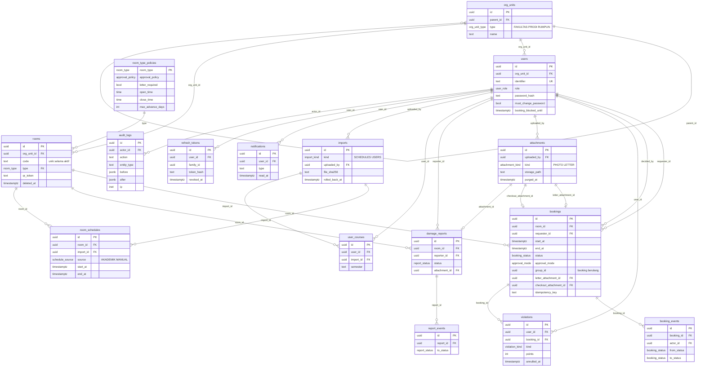

# ERD ClassLab

Skema PostgreSQL setelah migrasi `000009` (000009 hanya menambah trigger, tanpa tabel atau kolom baru). Sumber kebenarannya tetap berkas di `migrations/`; diagram ini
dibuat dari database yang sudah dimigrasi dan hanya memuat kolom yang menjelaskan hubungan antartabel.
Semua primary key bertipe `uuid`, semua waktu `timestamptz`.



## Catatan

- **Ada tabel lain yang bukan data aplikasi:** `schema_migrations` milik golang-migrate (satu baris, versi
  migrasi saat ini).
- **Relasi ke `users` yang tidak digambar** agar diagram terbaca: `imports.rolled_back_by`,
  `violations.annulled_by`, `booking_events.actor_id`, `report_events.actor_id`, `damage_reports.handled_by`,
  dan `room_schedules.created_by`.
- **Dua lampiran per booking:** surat pengajuan (`letter_attachment_id`) dan foto check-out
  (`checkout_attachment_id`) sama-sama menunjuk `attachments`. Berkas fisiknya ada di `UPLOAD_DIR`; setelah
  masa simpan lewat, berkasnya dihapus dan baris `attachments` diberi `purged_at`.
- **Ruang dan jam tidak bisa terpakai dua kali, dijaga database:** constraint `EXCLUDE` menolak dua
  booking aktif (MENUNGGU, DISETUJUI, BERLANGSUNG) yang tumpang tindih di satu ruang, dan dua jadwal yang
  tumpang tindih. Booking vs jadwal ada di dua tabel, jadi dijaga trigger `bookings_no_schedule_overlap` dan
  `room_schedules_no_booking_overlap` (migrasi 000009) yang mengunci baris ruang lalu menolak dengan kode
  `23P01`. Lapisan pertamanya tetap kunci `rooms ... FOR UPDATE` di service.
- **`audit_logs`:** `actor_id` mengacu ke `users` tetapi boleh kosong (aksi sistem). `entity_id` tidak punya
  foreign key karena `entity_type` yang menentukan tabel tujuannya.
- **Enum:** `user_role` (MAHASISWA, ORGANISASI, TU, KALAB, OB, ADMIN), `booking_status` (MENUNGGU,
  DISETUJUI, DITOLAK, DIBATALKAN, BERLANGSUNG, SELESAI, TIDAK_HADIR, TANPA_CHECKOUT, KEDALUWARSA),
  `room_type` (KELAS, LAB, AUDITORIUM, RUANG_UJIAN, RUANG_SIDANG), `report_status` (BARU, DITERIMA,
  DIPROSES, SELESAI), `violation_kind` (TIDAK_HADIR, TANPA_CHECKOUT, BATAL_TERLAMBAT), `manual_reason`
  (ROOM_POLICY, ORGANIZATION, VIOLATION_HISTORY).

## Membuat ulang diagram

Setelah menambah migrasi, perbarui diagram ini dari database yang sudah dimigrasi:

```sh
# kolom
docker exec classlab-postgres psql -U classlab -d classlab -c "\d+ bookings"
# semua foreign key
docker exec classlab-postgres psql -U classlab -d classlab -At -c \
  "select conrelid::regclass, confrelid::regclass from pg_constraint where contype='f' order by 1"
```
